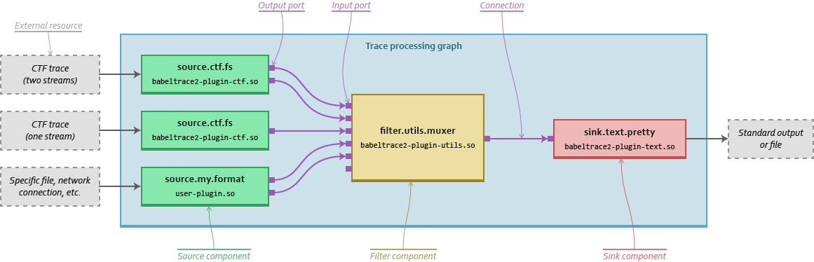

// SPDX-FileCopyrightText: 2019-2026 Philippe Proulx <pproulx@efficios.com>
//
// SPDX-License-Identifier: CC-BY-SA-4.0

// Render with Asciidoctor

= Babeltrace 2
9 July 2026
:btversion: 2.1
:bt2: Babeltrace{nbsp}2
ifdef::env-github[]
:toc: macro
endif::[]
ifndef::env-github[]
:toc: left
endif::[]

Babeltrace /ˈbæbəltreɪs/, an
https://efficios.com/[EfficiOS] project, is an open-source
https://en.wikipedia.org/wiki/Tracing_(software)[trace]
manipulation framework.

https://ci.lttng.org/job/babeltrace_master_linuxbuild[image:https://img.shields.io/jenkins/s/https/ci.lttng.org/babeltrace_master_linuxbuild.svg[]]
https://scan.coverity.com/projects/babeltrace[image:https://img.shields.io/coverity/scan/babeltrace.svg[]]

The **_{bt2}_** project offers a library with a
https://babeltrace.org/docs/v{btversion}/libbabeltrace2[C{nbsp}API],
https://babeltrace.org/docs/v{btversion}/python/bt2[Python{nbsp}3 bindings],
and a
https://babeltrace.org/docs/v{btversion}/man1/babeltrace2.1/[command-line tool]
(CLI) which makes it very easy for mere mortals to view, convert,
transform, and analyze traces.

{bt2} is also the reference parser implementation of the
https://diamon.org/ctf/[Common Trace Format] (CTF), a flexible
trace format which various tracers and tools such as
https://lttng.org/[LTTng] and
https://barectf.org/[barectf] produce natively.
The {bt2} library and its Python bindings can read and write CTF traces.

See the {bt2} https://babeltrace.org[official website], in
particular the
https://babeltrace.org/docs/v{btversion}/man7/babeltrace2-intro.7[`**babeltrace2-intro**(7)`]
manual page, to learn more about the project.

[NOTE]
ifdef::env-github[]
.**Babeltrace{nbsp}1 vs. {bt2}**
endif::[]
ifndef::env-github[]
.Babeltrace{nbsp}1 vs. {bt2}
endif::[]
====
The Babeltrace project exists since 2010.

In 2020, {bt2} was released. {bt2} is a complete rewrite of the library,
Python bindings, and CLI. It's plugin-based and offers much more
features and potential than Babeltrace{nbsp}1 while delivering
comparable performance.

Some Linux distributions still provide packages for the
Babeltrace{nbsp}1 project. Both projects can coexist on the same system
as there are no conflicting files.

This README documents the **{bt2}** project.
====

ifdef::env-github[]
toc::[]
endif::[]

== Build Babeltrace{nbsp}{btversion} from source

=== Build-time requirements

To build Babeltrace{nbsp}{btversion}, you need:

Compiler::
    * Any https://gcc.gnu.org/[GCC]-like compiler with C99 and
      https://gcc.gnu.org/onlinedocs/gcc/C-Extensions.html[GNU extension]
      support.
+
https://clang.llvm.org/[Clang] is one of those.

    * Any {cpp} compiler with {cpp}17 support (for example,
      GCC{nbsp}≥{nbsp}7.5 and Clang{nbsp}≥{nbsp}5).

Tools::
    * https://www.gnu.org/software/make/[GNU Make]
    * **If you build from a Git clone**:
    ** https://www.gnu.org/software/automake/[GNU Automake]{nbsp}≥{nbsp}1.13
    ** https://www.gnu.org/software/autoconf/[GNU Autoconf]{nbsp}≥{nbsp}2.69
    ** https://www.gnu.org/software/libtool/[GNU Libtool]{nbsp}≥{nbsp}2.2
    ** https://github.com/westes/flex[flex]{nbsp}≥{nbsp}2.5.35
    ** https://www.gnu.org/software/bison/bison.html[GNU Bison]{nbsp}≥{nbsp}3.0

Libraries::
    * A C library (for example,
      https://www.gnu.org/software/libc/[GNU{nbsp}C Library],
      https://www.musl-libc.org/[musl libc])

    * https://developer.gnome.org/glib/[GLib]{nbsp}≥{nbsp}2.56
      (Debian/Ubuntu: `libglib2.0-dev`; Fedora: `glib2-devel`)

    * https://fmt.dev/[pass:[{fmt}]]{nbsp}≥{nbsp}10.1.1
      (Debian/Ubuntu: `libfmt-dev`; Fedora: `fmt-devel`)
+
Use an in-tree pass:[{fmt}] with `--enable-vendor-fmt` if you can't
install it.

_**If you need the `bt2` Python bindings**_::
    * https://www.python.org[Python]{nbsp}≥{nbsp}3.6 (development
      libraries and `python3-config`)
      (Debian/Ubuntu: `python3-dev`; Fedora: `python3-devel`)

_**If you need the https://lttng.org/[LTTng] debug information filter component class (https://babeltrace.org/docs/v{btversion}/man7/babeltrace2-filter.lttng-utils.debug-info.7/[`filter.lttng-utils.debug-info`])**_::
    * https://sourceware.org/elfutils/[elfutils]{nbsp}≥{nbsp}0.154
      (Debian/Ubuntu: `libelf-dev` and `libdw-dev`;
      Fedora: `elfutils-devel` and `elfutils-libelf-devel`)

_**If you need the {bt2}{nbsp}C{nbsp}API HTML documentation**_::
    * http://www.doxygen.nl/[Doxygen]{nbsp}≥{nbsp}1.8.6

_**If you need the {bt2} manual pages**_ (only if you build from a Git clone)::
    * https://asciidoctor.org/[Asciidoctor]{nbsp}≥{nbsp}2.0.15
    * https://pagure.io/xmlto[xmlto]{nbsp}≥{nbsp}0.0.25
    * The namespaced DocBook XSL stylesheets (often named
      `docbook-xsl-ns`).

_**If you need the `bt2` Python bindings documentation**_::
    * https://www.sphinx-doc.org/[Sphinx]{nbsp}≥{nbsp}1.3 for
      Python{nbsp}3
      (Debian/Ubuntu/Fedora: `python3-sphinx`)

_**If you need to build and run the tests**_:: {empty}
+
--
* https://www.python.org[Python]{nbsp}≥{nbsp}3.6 (development
  libraries and `python3-config`)
  (Debian/Ubuntu: `python3-dev`; Fedora: `python3-devel`)

* https://docs.pytest.org/[pytest]{nbsp}≥{nbsp}7.0.0
  (Debian/Ubuntu/Fedora: `python3-pytest`)
+
Use an in-tree pytest with `--enable-vendor-pytest` if you can't
install it.

* https://github.com/catchorg/Catch2[Catch2]{nbsp}≥{nbsp}3.7.1
  (Debian/Ubuntu: `libcatch2-dev`)
+
Use an in-tree Catch2{nbsp}v3 with `--enable-vendor-catch2` if you can't
install it.
--
+
Disable test building with `--disable-tests` at configuration time.

[NOTE]
ifdef::env-github[]
.**Thanks for the code!**
endif::[]
ifndef::env-github[]
.Thanks for the code!
endif::[]
====
We'd like to thank the authors of the following projects which are
embedded into the {bt2} source tree:

* https://github.com/catchorg/Catch2[Catch2] (with `--enable-vendor-catch2`)
* https://github.com/fmtlib/fmt[pass:[{fmt}]] (with `--enable-vendor-fmt`)
* https://github.com/nlohmann/json[JSON for Modern {cpp}]
* https://github.com/martinmoene/span-lite[span lite]
* https://github.com/quicknir/wise_enum[wise_enum]
* https://github.com/wonder-mice/zf_log[zf_log]
====

=== Procedure

To build {bt2}:

. **If you build from a Git clone**, do:
+
[role="term"]
----
$ ./bootstrap
----
+
This generates the `configure` script and other important files.

. [[conf]]Configure the project:
+
[role="term"]
----
$ ./configure
----
+
--
The following options can modify the build:

`--disable-debug-info`::
    Do _not_ build the https://lttng.org/[LTTng] debug information
    filter component class
    (https://babeltrace.org/docs/v{btversion}/man7/babeltrace2-filter.lttng-utils.debug-info.7/[`filter.lttng-utils.debug-info`]).

`--disable-man-pages`::
    Do _not_ build the {bt2} manual pages.

`--disable-python-bindings`::
    Do _not_ build the `bt2` Python bindings.
+
Because tests need those Python bindings, you must also specify
`--disable-tests`.

`--disable-python-plugins`::
    Do _not_ build support for {bt2} Python plugins.
+
Because tests need Python plugin support, you must also specify
`--disable-tests`.

`--disable-tests`::
    Do _not_ build the tests at all.
+
In that case, the `check` Make target still works, but it doesn't
run any test and exits with status{nbsp}0.

`--enable-api-doc`::
    Build the {bt2}{nbsp}C{nbsp}API HTML documentation.

`--enable-asan`::
    Build with
    https://clang.llvm.org/docs/AddressSanitizer.html[AddressSanitizer].

`--enable-built-in-plugins`::
    Statically link the official plugins into the
    `babeltrace2` executable.

`--enable-built-in-python-plugin-support`::
    Statically link the Python plugin provider into libbabeltrace2.

`--enable-python-bindings-doc`::
    Build the `bt2` Python bindings documentation.

`--enable-vendor-catch2`::
    Use an in-tree Catch2 instead of an installed one.

`--enable-vendor-fmt`::
    Use an in-tree pass:[{fmt}] instead of an installed one.

`--enable-vendor-pytest`::
    Use an in-tree pytest instead of an installed one.

`--enable-ubsan`::
    Build with
    https://clang.llvm.org/docs/UndefinedBehaviorSanitizer.html[UndefinedBehaviorSanitizer].

The following environment variables can modify the build:

`BABELTRACE_DEBUG_MODE`::
    Set to `1` to enable the debug mode.
+
The debug mode enables more run-time assertions to detect bugs while
developing the {bt2} project.

`BABELTRACE_DEV_MODE`::
    Set to `1` to enable the <<dev-mode,developer mode>>.
+
The {bt2} developer mode enables more precondition and postcondition
assertions to detect C{nbsp}API usage errors.

`BABELTRACE_MINIMAL_LOG_LEVEL`::
    Set the build-time, minimal logging level for all the modules
    of the project.
+
Set to `TRACE`, `DEBUG`, or `INFO`.

`BABELTRACE_PLUGIN_PROVIDERS_DIR`::
    Installation directory of {bt2} plugin providers.

`BABELTRACE_PLUGINS_DIR`::
    Installation directory of {bt2} official plugins.

`PKG_CONFIG_PATH`::
    Directories to add to the search path of `pkg-config`.

`PKG_CONFIG`::
    Path to custom `pkg-config` program.

`PYTHON_CONFIG`::
    Path to custom `python3-config` program.

`PYTHON`::
    Path to custom `python3` program.

Run `./configure --help` to list all the available options and
environment variables.
--

. Build {bt2}:
+
[role="term"]
----
$ make
----

To install {bt2}:

* Run:
+
[role="term"]
----
# make install
----

[[dev-mode]]
=== Build {bt2} for plugin or application development

If you're developing a {bt2} plugin or an application which uses
libbabeltrace2, we recommend to:

* Build {bt2} from source in _developer mode_.
+
The {bt2} developer mode enables more precondition and postcondition
assertions to detect C{nbsp}API usage errors.
+
The
https://babeltrace.org/docs/v{btversion}/libbabeltrace2[{bt2}{nbsp}C{nbsp}API documentation]
always lists the precondition and postconditions of
functions.
+
Set `BABELTRACE_DEV_MODE=1` when you <<conf,configure>> the {bt2} build.

* Use _TRACE_ as the minimal logging level at build time to have
  access to more logging, should you need it to debug your plugin or
  application.
+
Set `BABELTRACE_MINIMAL_LOG_LEVEL=TRACE` when you <<conf,configure>>
the {bt2} build.

{bt2} development build configuration command line example:

[role="term"]
----
$ BABELTRACE_DEV_MODE=1 BABELTRACE_MINIMAL_LOG_LEVEL=TRACE ./configure
----

See the
https://babeltrace.org/docs/v{btversion}/libbabeltrace2[{bt2}{nbsp}C{nbsp}API
documentation] for more information.

== Use Babeltrace{nbsp}{btversion}

See the https://babeltrace.org[{bt2} website] to learn how to use the
different parts of the project.

If you're new to {bt2}, make sure to read the
https://babeltrace.org/docs/v{btversion}/man7/babeltrace2-intro.7[`**babeltrace2-intro**(7)`]
manual page to familiarize yourself with the project.

=== Run-time requirements

Libraries:: {empty}
+
* A C library (for example,
  https://www.gnu.org/software/libc/[GNU{nbsp}C Library] or
  https://www.musl-libc.org/[musl libc])

* https://developer.gnome.org/glib/[GLib]{nbsp}≥{nbsp}2.56
  (Debian/Ubuntu: `libglib2.0-0`; Fedora: `glib2`)

_**If you need the `bt2` Python bindings**_:: {empty}
+
* https://www.python.org[Python]{nbsp}≥{nbsp}3.6
  (Debian/Ubuntu/Fedora: `python3`)

_**If you need the https://lttng.org/[LTTng] debug information filter component class (https://babeltrace.org/docs/v{btversion}/man7/babeltrace2-filter.lttng-utils.debug-info.7/[`filter.lttng-utils.debug-info`])**_:: {empty}
+
* https://sourceware.org/elfutils/[elfutils]{nbsp}≥{nbsp}0.154
  (Debian/Ubuntu: `libelf` and `libdw`; Fedora: `elfutils-libs` and
  `elfutils-libelf`)

== Community

Babeltrace was born to parse CTF traces produced by LTTng{nbsp}2.0 and
to pretty-print their events.

Even though {bt2} is independent from the LTTng project today, their
communities remain very close, which is why they share some
communication channels and services:

Mailing list::
    https://lists.lttng.org/cgi-bin/mailman/listinfo/lttng-dev[lttng-dev]
    (mailto:lttng-dev@lists.lttng.org[lttng-dev@lists.lttng.org])

IRC channel::
    irc://irc.oftc.net/lttng[`#lttng`] on the OFTC network

Bug tracker::
    https://bugs.lttng.org/projects/babeltrace[{bt2} bug tracker]

GitHub project::
    https://github.com/efficios/babeltrace/[efficios/babeltrace]

Continuous integration::
    https://ci.lttng.org/view/Babeltrace/[{bt2} jobs]
    on the LTTng CI

Code review::
    https://review.lttng.org/q/project:babeltrace[{bt2} project]
    on LTTng Review (Gerrit)
